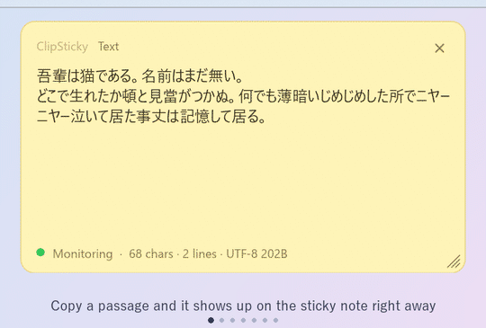
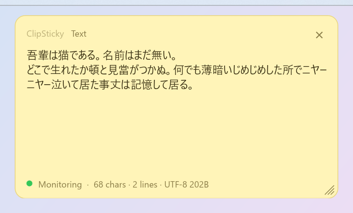
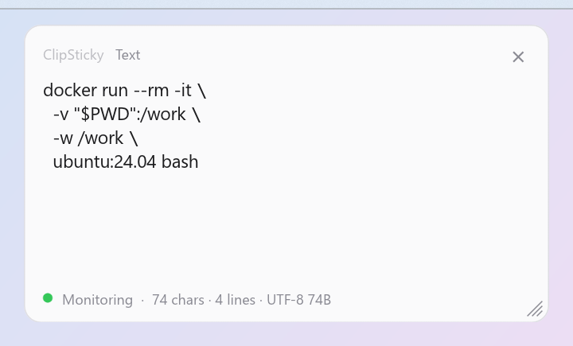
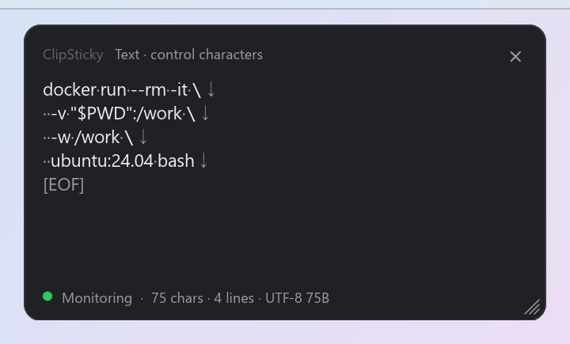
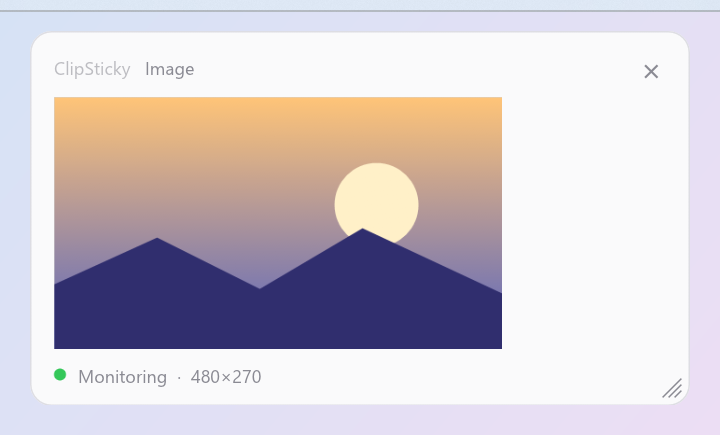
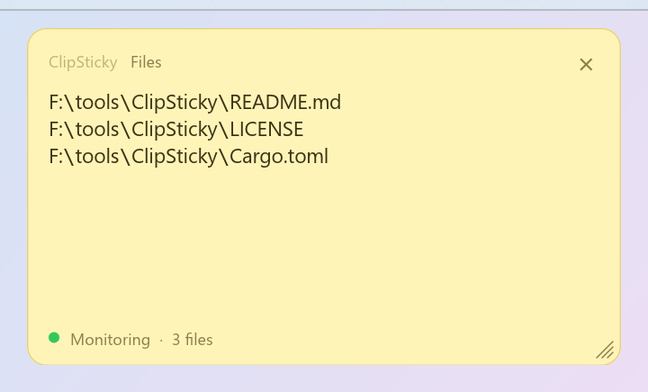
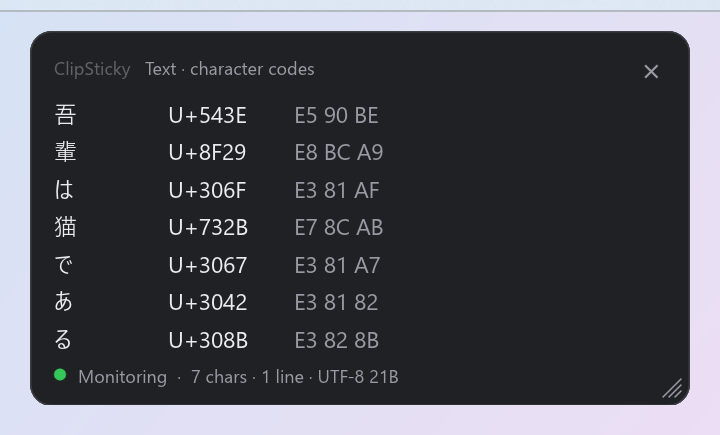
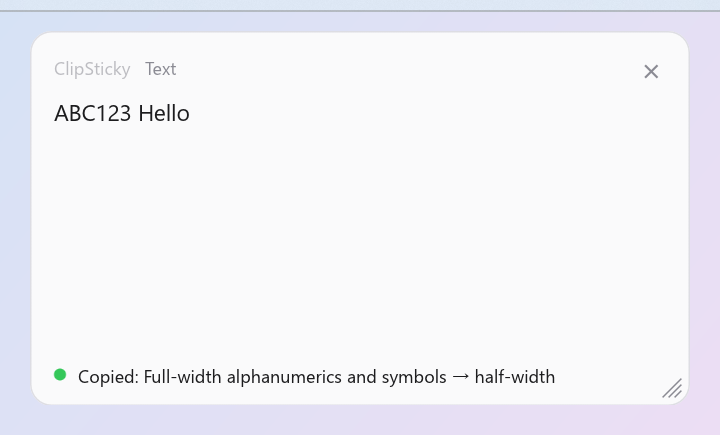

# ClipSticky

[日本語](README.md) | **English** | [Website](https://equinox79.github.io/ClipSticky/en/)

A small resident app that shows the latest clipboard contents as a sticky note in the corner of your screen.
The note updates every time you copy, and it never steals focus from the app you are working in.
Runs on Windows and macOS (written in Rust).

<p align="center">
  
</p>

## Features

- **See it**: text, images and files (a list of the copied file paths)
- **Stay out of the way**: always on top, but never takes focus; no taskbar / Dock entry
- **Check it**: shows control and invisible characters, a character code list, and character / line / byte counts
- **Fix it**: convert line endings, full-width ⇔ half-width, Unicode normalization and more, then put the result back on the clipboard
- **Make it yours**: themes (Yellow / Light / Dark), opacity, background image, font, and UI language (日本語 / English)
- **Resident**: lives in the system tray / menu bar

> **About the macOS build**: verified on an Apple M2 Mac. Intel Macs and other macOS versions are untested.
> If something does not work, please open an issue.

## Screenshots

The UI is shown in English. The copied text is Japanese in some of the shots.

<table>
  <tr>
    <td align="center"><br>Prose, shown as is</td>
    <td align="center"><br>Check a multi-line command</td>
    <td align="center"><br>Show control characters to spot a trailing newline</td>
  </tr>
  <tr>
    <td align="center"><br>Images are shown too</td>
    <td align="center"><br>Copied files appear as a path list</td>
    <td align="center"><br>Character codes (Unicode / UTF-8)</td>
  </tr>
  <tr>
    <td align="center"><br>Convert line endings and more, then re-copy</td>
  </tr>
</table>

With "Show control characters" on, you can see at a glance whether a copied multi-line command ends with a newline (`↓`).
That helps you avoid accidentally running it when you paste into a terminal.

The sample text is the opening of Natsume Sōseki's "I Am a Cat" (1905), which is in the public domain.
The image was drawn for this README.

## Install

Download the zip for your OS from [Releases](https://github.com/equinox79/ClipSticky/releases).
Each file comes with a `.sha256` file so you can verify the download.

### Windows

1. Extract `ClipSticky-vX.Y.Z-windows-x64.zip`
2. Put `clipsticky.exe` anywhere you like and run it

There is no installer. To uninstall, delete the exe (settings stay in `%APPDATA%\ClipSticky`).

The exe is not code-signed, so SmartScreen may show a warning on first launch. Choose "More info" → "Run anyway".

### macOS

1. Extract `ClipSticky-vX.Y.Z-macos-universal.zip` (works on both Apple Silicon and Intel)
2. Move `ClipSticky.app` to Applications
3. Open it the first time using one of the methods below

The app is not notarized by Apple (which costs money), so macOS says it cannot verify the developer on first launch.

- **Right-click `ClipSticky.app` → Open**
- Or remove the quarantine attribute in Terminal: `xattr -dr com.apple.quarantine /Applications/ClipSticky.app`

There is no Dock icon; the app appears in the menu bar.

### Build from source

You need [Rust](https://www.rust-lang.org/tools/install) (stable).

```sh
cargo run --release
```

- Windows: `target\release\clipsticky.exe` runs standalone.
- macOS: `./packaging/macos/build-app.sh` builds `target/macos/ClipSticky.app` and a zip (ad-hoc signed).

## Usage

| Action | Result |
| --- | --- |
| Copy to the clipboard | Shows the contents and brings the window to the front (without taking focus) |
| Drag the window | Move |
| Drag an edge or the bottom-right grip | Resize |
| Mouse wheel | Scroll long text |
| × at the top right | Hide the window (the app keeps running) |
| Right-click the window | Open the menu |
| Tray / menu bar icon | Left- or right-click opens the menu |

### Menu

Right-clicking the window and clicking the tray / menu bar icon open the same menu.

| Item | What it does |
| --- | --- |
| Show | Bring back a hidden window |
| Pause / Resume monitoring | Whether to react to clipboard changes |
| Text view | Normal / Show control characters / Character codes ([details](#text-views)) |
| Convert text and copy | Line endings, whitespace trimming, full/half width, normalization, case ([details](#text-conversion); available only for text) |
| Theme | Yellow / Light / Dark |
| Opacity | 100% to 50% (default 96%). Only the background becomes transparent, not the text |
| Background image | Choose / clear an image (you can also drop an image file onto the window) |
| Font | Choose the typeface and size / reset to default ([details](#font)) |
| 言語 / Language | Auto (follows the OS language; English on non-Japanese systems) / 日本語 / English. Takes effect immediately |
| Exit | Quit the app |

The "言語 / Language" item is always written in both languages, so you can find it even if the UI is in a language you cannot read.

### Text views

The footer shows the character count, line count and UTF-8 byte count (e.g. `28 chars · 3 lines · UTF-8 58B`).

- **Normal**: shown as is (tabs are expanded to 4-column stops).
- **Show control characters**: like an editor's "show invisibles", faint symbols are overlaid on the text.

  | Character | Shown as |
  | --- | --- |
  | Line break CRLF / LF / CR | `↵` / `↓` / `←` (the line also really breaks after the symbol) |
  | Tab | `→` (padded with spaces to the next tab stop, every 4 columns) |
  | Space / ideographic space / NBSP | `·` / `□` / `°` |
  | End of text | `[EOF]` (shows whether there is a trailing newline) |
  | Other control / invisible characters | By name, such as `⟦NUL⟧`, `⟦ZWSP⟧`, `⟦BOM⟧` |
- **Character codes**: one character per line, listing the character, its Unicode code point, its UTF-8 bytes, and its name (for control characters and the like).

In every view only the first 20,000 characters are shown (1,000 in the character code list); the rest is omitted.

### Text conversion

"Convert text and copy" in the menu converts the text currently shown and puts the result back on the clipboard
(the window also switches to the converted text). If nothing changes, the app tells you so.

| Group | What it does |
| --- | --- |
| Line endings | Normalize to LF (Linux / macOS), CRLF (Windows) or CR |
| Remove whitespace / newlines | Remove trailing newlines / trim leading and trailing whitespace / trim whitespace at the end of each line |
| Full / half width | Full-width alphanumerics and symbols ⇔ half-width, half-width kana ⇔ full-width kana (including voiced marks) |
| Unicode normalization | NFC (composed; fixes decomposed voiced marks in macOS file names) / NFD (decomposed) / NFKC (`㈱` → `(株)`, `①` → `1`) |
| Case | To lowercase / to uppercase |

If "Show control characters" reveals a trailing newline (`↓`), "Remove trailing newlines" fixes it right away.

### Font

"Font" → "Choose font…" lets you pick from the installed fonts and set the body text size
(changes apply immediately; OK confirms, Cancel reverts).
Small text such as the app name and the footer has a fixed size.

The defaults are Yu Gothic UI on Windows and Hiragino Sans on macOS, at 15px.

### Background image

PNG / JPEG / BMP / GIF / WebP are supported. The image covers the whole note with its aspect ratio kept (the overflow is cropped around the center),
and a layer in the theme color is placed on top so the text stays readable. You can change its strength with `SCRIM_ALPHA` in `src/app.rs`.
Large images are scaled down to 1280px on the long side when loaded.

## Settings file

Position, size, opacity, theme, view, language, background image and font are saved here:

- Windows: `%APPDATA%\ClipSticky\settings.txt`
- macOS: `~/Library/Application Support/ClipSticky/settings.txt`

It is a plain `key=value` file that you can edit by hand. Position and size are in logical points (independent of display scaling).

```
left=1500.0
top=24.0
width=380.0
height=220.0
opacity=96
theme=yellow
view=normal
language=auto
background=C:\Users\me\Pictures\wallpaper.png
font=Meiryo
font_size=16
```

| Key | Values |
| --- | --- |
| `theme` | `yellow` / `light` / `dark` |
| `view` | `normal` / `controls` / `codes` |
| `language` | `auto` / `ja` / `en` |

`background`, `font` and `font_size` are optional. Delete the file to go back to the defaults.

## How it works

The GUI uses [egui](https://github.com/emilk/egui) (eframe), with the same drawing code on Windows and macOS. Only the OS-specific parts live in `platform/`.

```
src/
  main.rs        startup (window setup)
  app.rs         drawing and interaction (egui)
  clipboard.rs   clipboard monitoring and reading (arboard); writing converted text is in app.rs
  menu.rs        menus (muda) and the tray icon (tray-icon)
  fonts.rs       loading system fonts (fontdb)
  core/          OS-independent code, with unit tests
    content.rs     clipboard content types
    text.rs        control character display, character code list, counts
    convert.rs     text conversion (line endings, full/half width, normalization, ...; unicode-normalization)
    settings.rs    reading and writing settings
    i18n.rs        UI language switching (Japanese / English); strings are written in both languages where they are used (tr(...))
    theme.rs       colors
  platform/
    windows.rs   no-focus style, show/hide, borders, showing menus
    macos.rs     accessory app, topmost on all Spaces, show/hide, showing menus
```

- A separate thread polls the clipboard change counter (Windows: `GetClipboardSequenceNumber`, macOS: `NSPasteboard.changeCount`)
  every 150 ms and reads the clipboard when it changes. If another process is using it, it retries up to 5 times at 50 ms intervals.
- The window is transparent and borderless; the rounded corners, background and opacity are drawn by the app itself.

<details>
<summary>Window tricks on Windows</summary>

- winit rewrites the window's extended styles, so the no-focus style (`WS_EX_NOACTIVATE`) is checked and re-applied every frame,
  and show/hide call Win32 directly.
- DWM draws the outermost 1px of the non-client area as an opaque line, so the drawing region is clipped to the client area (`SetWindowRgn`)
  to keep that line from showing outside the rounded corners.
- The title bar style (`WS_CAPTION`) that winit keeps for the shadow is removed, and frame repainting (`WM_NCACTIVATE`, `WM_NCPAINT`) is suppressed.
  Without this, when the right-click menu activates the window, Windows draws a title bar and frame, leaving a white band on the top and left of the note.

</details>

## License

[MIT License](LICENSE)
