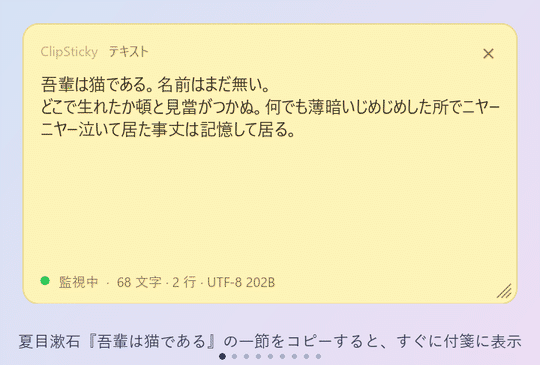
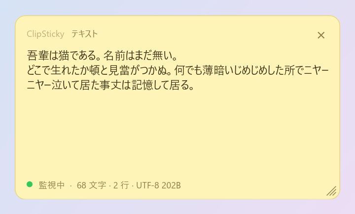
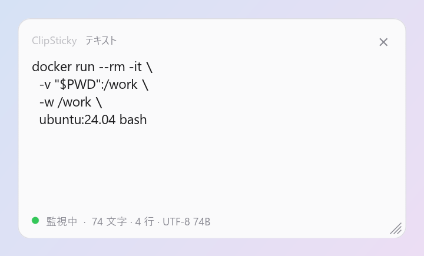
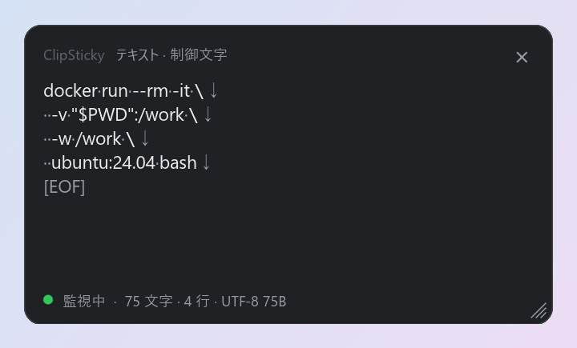
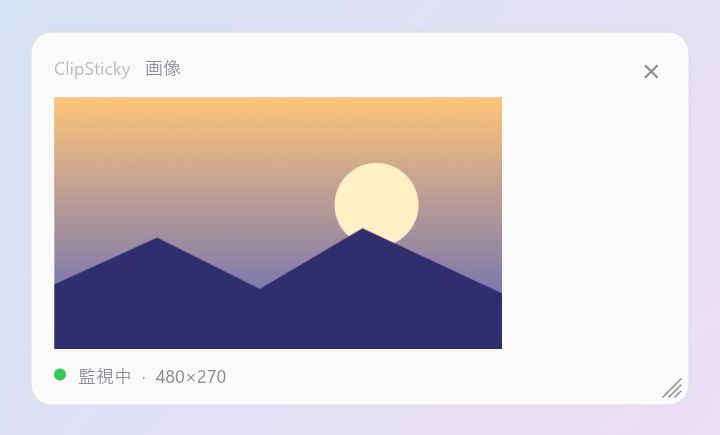
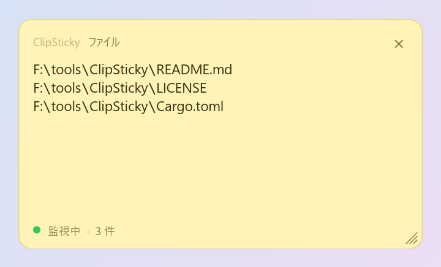
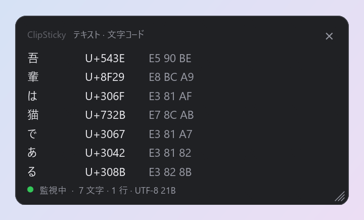
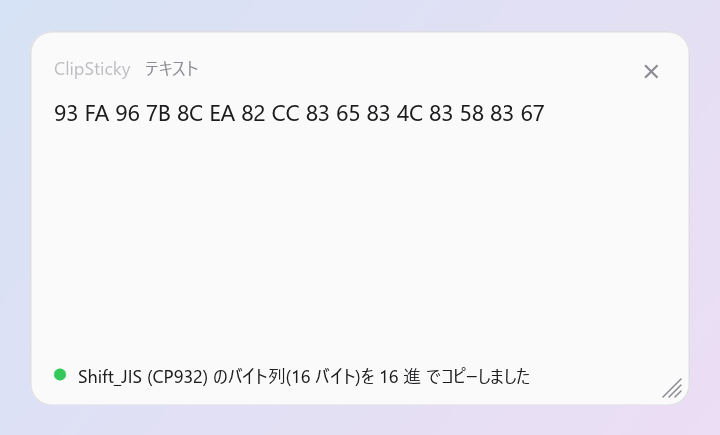

# ClipSticky

**日本語** | [English](README.en.md)

クリップボードの最新の内容を、画面の隅に付箋のように表示する小さな常駐アプリです。
コピーするたびに表示が更新され、他のアプリのフォーカスは奪いません。Windows と macOS に対応しています(Rust 製)。

<p align="center">
  
</p>

## 特長

- **見える**: テキスト・画像・ファイル(コピーしたファイルのパス一覧)を表示
- **邪魔しない**: 最前面に出ても、フォーカスを奪わない。タスクバー / Dock には出ない
- **確かめられる**: 制御文字・不可視文字の表示、文字コード一覧、文字数・行数・バイト数
- **直せる**: 改行コード、全角⇔半角、Unicode 正規化などを変換して、クリップボードに入れ直す
- **好みに合わせる**: テーマ(イエロー / ライト / ダーク)、透明度、背景画像、フォント、表示言語(日本語 / English)
- **常駐**: タスクトレイ / メニューバー

> **macOS 版について**: Apple M2 の Mac で動作を確認しています。Intel の Mac や、ほかの macOS のバージョンでは未確認です。
> 不具合があれば Issue で教えてください。

## スクリーンショット

<table>
  <tr>
    <td align="center"><br>文章をそのまま表示</td>
    <td align="center"><br>複数行のコマンドを確認</td>
    <td align="center"><br>制御文字を表示して、末尾の改行に気づく</td>
  </tr>
  <tr>
    <td align="center"><br>画像もそのまま見られる</td>
    <td align="center"><br>コピーしたファイルはパスの一覧</td>
    <td align="center"><br>文字コード(Unicode / UTF-8)の一覧</td>
  </tr>
  <tr>
    <td align="center"><br>改行コードなどを変換して、クリップボードに入れ直す</td>
  </tr>
</table>

「制御文字を表示」にすると、コピーした複数行のコマンドの末尾に改行(`↓`)が含まれているかどうかが一目で分かります。
ターミナルに貼り付けたときに、うっかり実行されるのを防げます。

サンプルの文章は、夏目漱石『吾輩は猫である』(1905 年)の冒頭です。著作権の保護期間が満了しており、自由に利用できます。
画像は、このために描いたものです。

## インストール

[Releases](https://github.com/equinox79/ClipSticky/releases) から、お使いの OS 用の zip をダウンロードします。
どちらも `.sha256` ファイルで、ダウンロードしたファイルを確認できます。

### Windows

1. `ClipSticky-vX.Y.Z-windows-x64.zip` を展開する
2. `clipsticky.exe` を好きな場所に置いて実行する

インストーラーはありません。削除するときは exe を消すだけです(設定は `%APPDATA%\ClipSticky` に残ります)。

署名していないため、初回起動時に SmartScreen が警告を出すことがあります。その場合は「詳細情報」→「実行」を選んでください。

### macOS

1. `ClipSticky-vX.Y.Z-macos-universal.zip`(Apple Silicon・Intel 両対応)を展開する
2. `ClipSticky.app` を「アプリケーション」に移動する
3. 初回だけ、次のどちらかで開く

Apple の公証(有料)を受けていないため、初回は「開発元を検証できません」と表示されます。

- `ClipSticky.app` を**右クリック → 開く**
- または、ターミナルで検疫の属性を外す: `xattr -dr com.apple.quarantine /Applications/ClipSticky.app`

Dock には出ず、メニューバーにアイコンが出ます。

### ソースからビルド

[Rust](https://www.rust-lang.org/tools/install)(stable)が必要です。

```sh
cargo run --release
```

- Windows: `target\release\clipsticky.exe` が単体で動きます。
- macOS: `./packaging/macos/build-app.sh` で、`target/macos/ClipSticky.app` と zip を作れます(ad-hoc 署名)。

## 使い方

| 操作 | 内容 |
| --- | --- |
| クリップボードにコピー | 内容を表示し、ウィンドウを前面に出す(フォーカスは奪わない) |
| ウィンドウをドラッグ | 移動 |
| 端・右下のつまみをドラッグ | リサイズ |
| マウスホイール | 長いテキストのスクロール |
| 右上の × | ウィンドウを隠す(アプリは終了しない) |
| ウィンドウを右クリック | メニューを開く |
| トレイ / メニューバーのアイコン | 左クリック・右クリックのどちらでも、メニューが開きます |

### メニュー

ウィンドウの右クリックと、トレイ / メニューバーのアイコンで、同じメニューが開きます。

| 項目 | 内容 |
| --- | --- |
| 表示 | 隠れているウィンドウを出す |
| 監視を一時停止 / 再開 | クリップボードの更新に反応するかどうか |
| テキスト表示 | 通常 / 制御文字を表示 / 文字コード一覧([詳しくは](#テキストの表示形式)) |
| テキストを変換してコピー | 改行コード、空白の削除、全角・半角、正規化、大文字・小文字([詳しくは](#テキストの変換)。テキストのときだけ使えます) |
| テーマ | イエロー / ライト / ダーク |
| 透明度 | 100% 〜 50%(標準は 96%)。背景だけが透け、文字は透けません |
| 背景画像 | 画像を選択 / 解除(画像ファイルをウィンドウにドロップしても設定できます) |
| フォント | 書体とサイズを選ぶ / 既定に戻す([詳しくは](#フォント)) |
| 言語 / Language | 自動(OS の言語に従う。日本語以外の OS は English)/ 日本語 / English。選ぶとすぐに切り替わります |
| 終了 | アプリを終了する |

「言語 / Language」の項目の名前だけは、迷子にならないよう、常に二か国語で書いています。

### テキストの表示形式

下部には、文字数・行数・UTF-8 でのバイト数を表示します(例: `28 文字 · 3 行 · UTF-8 58B`)。

- **通常**: そのまま表示します(タブは 4 桁ごとに展開します)。
- **制御文字を表示**: エディタの「制御文字を表示」と同じように、記号だけを薄い色で重ねて表示します。

  | 文字 | 表示 |
  | --- | --- |
  | 改行 CRLF / LF / CR | `↵` / `↓` / `←`(記号の後ろで実際にも改行します) |
  | タブ | `→`(次のタブ位置まで空白で埋めます。4 桁ごと) |
  | 半角スペース / 全角スペース / NBSP | `·` / `□` / `°` |
  | テキストの終わり | `[EOF]`(末尾に改行があるかが分かります) |
  | そのほかの制御文字・不可視文字 | `⟦NUL⟧`、`⟦ZWSP⟧`、`⟦BOM⟧` のように名前で表示 |
- **文字コード一覧**: 1 文字 1 行で、文字 / Unicode コードポイント / UTF-8 のバイト列 / 名前(制御文字など)を並べます。

どの形式でも、表示は先頭の 20,000 文字(文字コード一覧は 1,000 文字)までで、超えた分は省略します。

### テキストの変換

メニューの「テキストを変換してコピー」で、いま表示しているテキストを変換し、結果をクリップボードに入れ直します
(画面の表示も、変換後の内容に変わります)。変化がないときは、その旨を知らせます。

| グループ | 内容 |
| --- | --- |
| 改行コード | LF(Linux・macOS)/ CRLF(Windows)/ CR にそろえる |
| 空白・改行の削除 | 末尾の改行を削除 / 前後の空白・改行を削除 / 行末の空白を削除 |
| 全角・半角 | 全角の英数・記号 ⇔ 半角、半角カナ ⇔ 全角カナ(濁点・半濁点も) |
| Unicode 正規化 | NFC(合成。macOS のファイル名の濁点を直す)/ NFD(分解)/ NFKC(`㈱` → `(株)`、`①` → `1`) |
| 大文字・小文字 | 小文字にする / 大文字にする |

「制御文字を表示」で末尾の改行(`↓`)に気づいたら、「末尾の改行を削除」でそのまま直せます。

### フォント

「フォント」→「フォントを選択…」で、インストール済みのフォントの一覧と、本文のサイズを選べます
(選ぶとすぐに反映され、OK で確定、キャンセルで元に戻ります)。
アプリ名やフッターなどの小さな文字は固定サイズです。

標準は、Windows が Yu Gothic UI、macOS が Hiragino Sans で、サイズは 15px です。

### 背景画像

PNG / JPEG / BMP / GIF / WebP に対応しています。縦横比を保ったまま全面に敷き(はみ出す部分は中央でトリミング)、
文字が読めるように上からテーマの色を重ねます。重ねる濃さは `src/app.rs` の `SCRIM_ALPHA` で変えられます。
大きな画像は読み込み時に長辺 1280px まで縮小します。

## 設定ファイル

位置・サイズ・透明度・テーマ・表示形式・言語・背景画像・フォントは、次の場所に保存されます。

- Windows: `%APPDATA%\ClipSticky\settings.txt`
- macOS: `~/Library/Application Support/ClipSticky/settings.txt`

`key=value` の行形式で、手で編集することもできます。位置とサイズの単位は論理ポイント(画面の拡大率に依存しない値)です。

```
left=1500.0
top=24.0
width=380.0
height=220.0
opacity=96
theme=yellow
view=normal
language=auto
background=C:\Users\me\Pictures\wallpaper.png
font=Meiryo
font_size=16
```

| キー | 値 |
| --- | --- |
| `theme` | `yellow` / `light` / `dark` |
| `view` | `normal` / `controls` / `codes` |
| `language` | `auto` / `ja` / `en` |

`background`、`font`、`font_size` は省略できます。ファイルを消すと初期状態に戻ります。

## 仕組み

GUI は [egui](https://github.com/emilk/egui)(eframe)で、Windows と macOS で同じ描画コードを使います。OS ごとに違う部分だけを `platform/` に分けています。

```
src/
  main.rs        起動(ウィンドウの設定)
  app.rs         描画と操作(egui)
  clipboard.rs   クリップボードの監視と読み取り(arboard)。変換結果の書き込みは app.rs
  menu.rs        メニュー(muda)とトレイアイコン(tray-icon)
  fonts.rs       システムのフォントの読み込み(fontdb)
  core/          OS に依存しない部分。単体テストあり
    content.rs     クリップボードの内容の型
    text.rs        制御文字の表示、文字コード一覧、文字数などの表示用の加工
    convert.rs     テキストの変換(改行コード、全角・半角、正規化など。unicode-normalization)
    settings.rs    設定の読み書き
    i18n.rs        表示言語の切り替え(日本語 / English)。文字列は、使う場所に日本語と英語を並べて書く(tr(...))
    theme.rs       配色
  platform/
    windows.rs   フォーカスを奪わないスタイル、表示/非表示、枠線、メニューの表示
    macos.rs     アクセサリアプリ化、全 Space で最前面、表示/非表示、メニューの表示
```

- クリップボードは、別スレッドで変更番号(Windows: `GetClipboardSequenceNumber`、macOS: `NSPasteboard.changeCount`)を
  150ms ごとに見て、変わったら読み取ります。他のプロセスが使用中のときは、50ms 間隔で最大 5 回リトライします。
- ウィンドウは透明な枠なしウィンドウで、角丸・背景・透明度は自前で描画しています。

<details>
<summary>Windows のウィンドウまわりの工夫</summary>

- winit がウィンドウの拡張スタイルを書き換えるため、フォーカスを奪わないスタイル(`WS_EX_NOACTIVATE`)を毎フレーム確認して付け直し、
  表示/非表示も Win32 を直接呼んでいます。
- DWM が非クライアント領域の最外周 1px を不透明な線として描くため、描画範囲をクライアント領域に切り詰めて(`SetWindowRgn`)、
  角丸の外側(四隅)に線が残らないようにしています。
- winit が影のために残しているタイトルバー(`WS_CAPTION`)を外し、枠の再描画(`WM_NCACTIVATE`・`WM_NCPAINT`)を止めています。
  これが無いと、右クリックメニューを出してウィンドウがアクティブになったときに、Windows がタイトルバーと枠を描いて、
  付箋の上と左に白い帯が出てしまいます。

</details>

## ライセンス

[MIT License](LICENSE)
